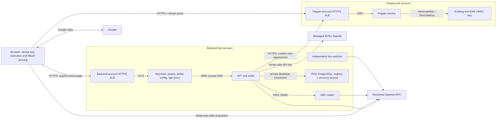

> Superseded comparison, retained 12 November 2026. The selected target is now two EC2 servers with PostgreSQL on the backend server. See [current review](HOSTING_REVIEW.md) and [current estimate](COST_ESTIMATE.md).

# Google-only Sepolia hosting review

**Initially prepared 12 November 2026 against `3ba7a39`; application baseline now `4be8467`. User scope/storage decisions recorded below. Technical review, implementation and deployment remain pending.**

This package is for the SNF AWS owner and wallet/security reviewers. It proposes how to host the Google-only Kamui test stack after the client-side proving migration using the two existing test accounts and `kamui.page`, whose DNS the user manages through Cloudflare. The user selected `https://sepolia.kamui.page` for an open Sepolia beta and `https://pepper-sepolia.kamui.page` for pepper. Neither is deployed; the production origin remains undecided.

No AWS account APIs, Terraform plan/apply, DNS, OAuth settings, cloud resources or security settings were changed. Only repository files, public documentation and local tool/image metadata were inspected. Account identifiers, resource identifiers and secret values belong in the operator's private records, not this packet. This is a focused deployment review, not a complete IAM audit or production readiness sign-off.

**User decision:** prove client-side using `snip-36-prover-wasm`; no hosted prover or automatic server fallback. The repository now prepares local browser execution/proving, authenticated deployment and durable proof jobs; an existing-account Google V2 JWT recovery passed locally against Sepolia in run 11; first deployment and hosted-origin acceptance remain pending. The pinned release, V2 migration and data-handling plan are in [CLIENT_PROVING.md](../../../keychain/CLIENT_PROVING.md). This packet describes the unapproved hosted target; it is not evidence of deployment or live browser compatibility.

**Recommendation, still pending technical review:** keep the existing ECS/Fargate approach for the open Sepolia beta; add a separately built keychain service, move the API behind it, and include the watcher. Implement the selected RDS PostgreSQL migration and resolve key-governance, public-abuse and spending-control gates before enabling public traffic. Do not apply the present Terraform unchanged.

## 0. User decisions — 12 November 2026

| Topic | Recorded decision | Boundary |
|---|---|---|
| Audience/origins | Open Sepolia beta at `sepolia.kamui.page` and `pepper-sepolia.kamui.page` | Replaces the invited-tester proposal. Google only, client proving and test funds remain the scope; deployment/DNS/security approvals are separate. |
| Persistence | Migrate the recovery journal and session registry to RDS PostgreSQL before hosting | Selects the direction; instance sizing, availability, credentials, application migration and cutover/restore design remain unreviewed. Current code/templates still use SQLite/EFS. |
| Cost | Prepare an itemized estimate first | No spending ceiling has been approved. Region/availability/edge controls and usage assumptions must be explicit in the estimate. |
| Estimate baseline | Existing two AWS test accounts, ECS/Fargate, `eu-west-1` | Selected for design/pricing; the AWS owner must verify existing key Region and policy before deployment. |
| Edge | AWS WAF at both public ALBs, Cloudflare DNS-only, API private behind keychain | Direction selected; rules, body handling, forwarded-address trust, privacy and effectiveness remain to be implemented/reviewed. |
| Sponsorship | Approved apps only, anonymous sponsorship off, explicit per-app/per-account/overall limits | Does not restrict wallet registration. Separate deploy/recovery budgets and AVNU external controls still need implementation and verification. |
| Reviewers | Not yet named | AWS, database, wallet/security, privacy and operations approvals remain pending. |

Open wallet access is selected, while fee sponsorship is restricted to approved apps with limits. A browser-visible app key alone is not evidence of app authorization; define the actual registration/authentication path. Persistent counters/debits and an operator pause path are required for restart-safe controls. Relayer-paid deployments/recoveries have their own budgets. Exact thresholds, signer setup, AVNU external controls and the operator remain unresolved. No controls were enabled by recording these choices.

## 1. Proposed topology

The user selected Cloudflare **DNS-only for the new test records**, not an HTTP intermediary. AWS WAF at both public ALBs is also selected for the design. Neither DNS nor WAF configuration was changed here. Proxied DNS routes HTTP through Cloudflare and would add a TLS/data-processing and client-address trust boundary; revisiting it requires a matching origin-access/header policy. DNS account control itself remains security-sensitive. [Cloudflare proxy modes](https://developers.cloudflare.com/dns/proxy-status/)

The backend-account ALB is reused for the keychain instead of adding a third ALB. Its public target becomes the keychain; the API has private service discovery and ingress only from that service. This retargeting is **not implemented**. The existing [ALB module](modules/https-alb/main.tf) has one target group; [backend/main.tf](backend/main.tf) currently attaches it directly to API port 3000.

### Service inventory and initial sizing

| Service | Account | Proposed tasks | Initial CPU / RAM | Exposure and data |
|---|---|---:|---|---|
| Keychain | Backend | 1 | 0.25 vCPU / 0.5 GiB, unmeasured starting point | ALB only, port 5173; public configuration; no signing credentials or database mount |
| API | Backend | Exactly 1 | 0.5 vCPU / 1 GiB, current template | Keychain only, port 3000; private database connection; injected backend secrets (RDS migration pending) |
| Rotator | Backend | 1 | 0.25 vCPU / 0.5 GiB, current template | Port 3001 for API health only; registry-owner signer |
| Watcher | Backend | 1 | 0.25 vCPU / 0.5 GiB, unmeasured starting point | No public listener; RPC and optional alert destination; no signing key |
| Pepper | Pepper | 1 | 0.25 vCPU / 0.5 GiB, current template | Its ALB only, port 8787; KMS task role; no exported HMAC key |

A demo-dapp service is not included in the baseline. The first HTTPS test can use the existing local Ping demo, configured with the new keychain URL and its server-side API proxy. Verify that cross-origin round trip in the acceptance drill. A later hosted demo needs a separate origin and its own reviewed routing/configuration.

No hosted prover task, port 9900, prover-account credential or cloud proof queue is included. They have been removed from the current templates; no AWS resource change has been applied. Browser assets add about 108 MiB before compression/glue; measure delivery and client resource needs for Kamui's real JWT workload. Unsupported browsers must receive a clear limitation, with no server fallback. See the [client integration plan](../../../keychain/CLIENT_PROVING.md).

Selected estimate baseline: `eu-west-1`, existing two test accounts and ECS/Fargate, subject to the AWS owner confirming the existing test key's Region and SNF policy. The operator must verify the actual key/Region, Fargate quota and reviewed image architecture. Steady CPU is 1.25 vCPU in the backend account and 0.25 vCPU in the pepper account; allow deployment headroom. No account quota was queried.

## 2. Decisions required from the reviewers

| ID | Decision to record | Proposed position / unresolved gate | Owner |
|---|---|---|---|
| R1 | Pilot scope and origins | User selected open Sepolia beta, Google only and test funds, at `sepolia.kamui.page` and `pepper-sepolia.kamui.page`; release/access protections and DNS changes still need review. Apex and production origin stay undecided. | Product + wallet security + DNS owner |
| R2 | Placement and permissions | User selected the existing two test accounts, ECS/Fargate and Ireland for estimating. Private tasks and separate task/execution roles remain the proposed design. Review deployment role and existing KMS/SCP/CloudTrail controls; no agent-applied policy changes. | AWS owner + security |
| R3 | Database persistence | User selected RDS PostgreSQL migration. Review application transactions/locks, database access, backup/restore, availability and cutover before replacing the current SQLite/EFS implementation. | AWS/database owner + wallet security |
| R4 | Public boundary | Backend ALB → keychain → private API; user selected DNS-only Cloudflare and AWS WAF at both public ALBs. Review open-beta ingress, rules and edge-abuse effectiveness; public DNS does not provide HTTP filtering. | AWS owner + wallet security |
| R5 | Artifacts and architecture | Pin Wasm/Worker source, manifests and checksums plus service image digests; validate licences, supported browsers, V2 Kamui compatibility and client resource measurements. | Release + prover owners |
| R6 | Signing and rotation | Decide who supplies test signers, registry governance and relayer funding ceiling. Use different signer accounts or coordinate nonce writers across processes. | Wallet security + operations |
| R7 | Sponsorship exposure | User selected approved-app sponsorship, anonymous off and explicit per-app/per-account/overall limits. Managed AVNU secret remains API-only; implement durable budgets and verify external spending controls. Local preflight bounds do not cap AVNU's final fee. | Paymaster operator + wallet security |
| R8 | Personal-data handling | Approve browser witness handling, pepper lookup and first-deployment token recipients, public-transaction logs, registry/journal retention, Region, vendor recipients, and edge/container logging rules. No identity/session replay analytics on keychain. | Privacy/legal + security |
| R9 | Operations and budget | User requested an itemized estimate before choosing a budget ceiling. Reviewers/on-call owner remain unassigned; approve costs, alert recipients, retention and restore procedure before deployment. | AWS owner + service owner |

Security architecture in this package needs its named owners' review. Licence, privacy, regulatory and public self-custody claims are not settled by a successful Sepolia test. Apple setup is outside this rollout.

## 3. Concrete implementation gaps

These changes remain to be implemented and reviewed; this document does not implement them. The user has selected client-side proving; AWS/security review concerns the implementation and deployment boundaries.

| Priority | Owning files | Required delta and review evidence |
|---|---|---|
| Blocker | [CLIENT_PROVING.md](../../../keychain/CLIENT_PROVING.md), SDK/keychain/relay | Review and validate the prepared pinned V2 Workers, in-memory witness handling, cancellation/capability checks, output binding and unsupported-browser UX. Test an actual Kamui proof on Sepolia before assuming current-class compatibility. Authenticated deployment and journaled client-proof submission are prepared; public server-proving routes are disabled and Terraform removes the hosted prover/task/discovery/port/credential. Review these changes together; no silent fallback. |
| Blocker | [keychain/server.ts](../../../keychain/server.ts), new keychain Docker/build files | Add an explicit production build from repository root (SDK + keychain dependencies), bundle at image build rather than boot, run as non-root, copy only required assets/runtime. Do not copy local env files, test recovery files, fixtures or backend secrets. Preserve CSP, no framing, no-store config, callback cleanup and text-only untrusted labels. Add independent `/live`. |
| Blocker | Keychain runtime/config | Remove production reliance on sibling backend env/deployment files. Separate a clearly public browser RPC URL from the backend's secret `RPC_URL`; current `/config.json` deliberately exposes its `RPC_URL` value. Supply class/client/pepper/public-origin settings explicitly. |
| Blocker | Keychain proxy | Limit body size to the supported backend limit, allow only approved routes/methods, bound complete upstream responses and sanitize transport errors. Current proxy buffers request bodies and forwards every `/api/*` path. Allow only the implemented `/api/relay`, `/api/recover/status` and `/api/deploy/authenticated` routes, alongside `/api/sponsor` and the three `/api/registry/sessions*` routes. Do not expose the old server-proving `/recover` or unguarded legacy `/relay`/`deploy` merely to make login work. Align the allow-list with the implemented protocol and limits. |
| Blocker | [backend/main.tf](backend/main.tf), ALB/service modules | Add keychain repository/service; move public target to it; give API private discovery; replace API public ingress with keychain-only ingress. Keep private metrics and explicitly deny `/metrics*` and `/api/metrics*` at both gateway and edge. Narrow internal-port egress to destination service security groups, rather than the module's current any-destination port rules. |
| Blocker | API + proxy configuration | Set and test the two-proxy client-address policy below. The template currently does not set `TRUSTED_PROXY_HOPS`; direct socket defaults would group clients under proxy addresses. |
| Blocker | [backend/secrets.tf](backend/secrets.tf), API task secret map | Add an empty `paymaster-api-key` secret reference and inject `PAYMASTER_API_KEY` only into API. Supply `PAYMASTER_URL` as public config; do not put the key in `api_extra_environment`, tfvars, image layers or browser config. Existing templates contain neither AVNU setting. |
| Blocker | Storage decision R3, [storage.tf](backend/storage.tf), registry/recovery stores, [recovery runbook](../../../services/backend/RECOVERY-JOBS.md) | Replace SQLite/EFS with the selected RDS PostgreSQL target. Implement and test atomic admission, unique active-account locks, compare-and-swap intent updates, nonce/replay storage and pruning. Define one-time cutover, migration verification, backup/restore and connection/credential handling. Preserve uncertain-transaction locks. Keep one API process until rate limits, spending state and relayer nonce ownership are independently safe to replicate. |
| Before pilot | Backend watcher task/ECR and [watcher Dockerfile](../../../services/backend/src/services/watcher/Dockerfile) | Add the currently absent watcher to Terraform, independently from rotator. No owner/relayer key. Provide RPC and an optional secret alert URL; verify heartbeat/lag alerts and delivery. Worker health does not require a public port. |
| Before pilot | API startup audiences + Terraform inputs | API startup and Terraform now allow absent Apple configuration. Verify a genuinely Google-only deployment while keeping existing configured support intact; frontend Apple option stays disabled and pepper Apple allow-list empty. Do not invent Apple credentials. |
| Before pilot | Wasm delivery and browser privacy | Serve pinned complete Worker/glue/executor/prover assets with correct MIME, versioned public caching and tested narrow CSP. No replay-lab persistence, witness logs or private RPC simulation. Measure download, memory, latency, token-expiry and cancellation behavior; no mobile/Safari/Firefox proving claim without evidence. |
| Before pilot | Open-beta edge and funding policy | Implement/review selected AWS WAF rate limiting at both ALBs (not yet enabled), large-proof request handling and separate durable budgets for deploy/recover and AVNU sponsorship. The current memory ledger does not establish restart-safe overall spending limits. Price these controls; exact settings and any WAF logging require AWS/security/privacy review. Application budgets and operator pause controls remain necessary. |
| Before pilot | Container health/termination and alerts | Add measured health/stop behavior, closed error logs, submission age/error alarms, API/pepper availability, registry/journal failures, relayer balance/spend, JWKS/watcher lag and ECS deployment failures. Test alerts with their owner. |

The existing code and live receipts remain useful evidence, but do not substitute for these cloud-specific changes. The previous test baselines are in [run 9](../../../spikes/s1/results/run-9-recovery-jobs-avnu.json), [run 10](../../../spikes/s1/results/run-10-device-session-recovery.md) and [Safari evidence](../../../keychain/SAFARI_STORAGE.md).

## 4. Trust boundaries and configuration contract

### Public and private values

| Consumer | Plain configuration | Credential/secret access |
|---|---|---|
| Keychain/browser | `KEYCHAIN_PUBLIC_ORIGIN=https://sepolia.kamui.page`, callback `/callback`, Google client ID, current Sepolia class hash, pinned Wasm profile/asset version, public browser RPC, `PEPPER_URL=https://pepper-sepolia.kamui.page`, polling interval | None. Device key stays in the browser vault; witness stays in browser memory during proving; no backend private env file in this image. |
| Keychain server | Above plus private `API_URL=http://api.<internal-domain>:3000`; empty Apple client setting | No backend or KMS signing credentials. |
| API | `CHAIN_ID=SN_SEPOLIA`, public chain addresses/class, Google audience, private rotator URL, pepper HTTPS URL, `TRUSTED_PROXY_HOPS=2`, explicit app budgets, AVNU Sepolia URL; database connection settings to be defined by the RDS migration (current SQLite path settings are not the target) | Relayer key, authenticated RPC URL if used, AVNU API key. No prover-account key. Any database credentials are API-only through the reviewed secret mechanism. |
| Rotator | Registry address and approved issuer policy; `CHAIN_ID=SN_SEPOLIA` | Registry-owner key and RPC only. It currently loops over the shared issuer list; Google-only behaviour must be specified during implementation. |
| Watcher | Registry address, chain, scan/alert settings | RPC and optional webhook secret; no signer. |
| Pepper | KMS source, operator-supplied key identity/check value, Google audience allow-list, `ALLOWED_ORIGINS=https://sepolia.kamui.page`, mandatory key proof, one trusted ALB proxy | Task role can use the approved KMS key; no HMAC material is exported or injected. |

The API key store integration uses ECS environment injection today; it keeps values out of task-definition literals, not out of the process. Rotating an injected secret requires replacing the task. Treat any future signer-service migration as a separate security design. [ECS secret injection](https://docs.aws.amazon.com/AmazonECS/latest/developerguide/secrets-envvar-secrets-manager.html)

TLS terminates at the ALBs. The proposed ALB-to-task and keychain-to-API hops use HTTP inside the VPC; any additional transport encryption is a reviewer decision. This is not an end-to-end TLS claim.

### Client addresses: DNS-only baseline

For the proposed path, let `C` be the actual client's address and `A` the ALB socket peer seen by the keychain:

1. ALB append mode makes the trusted rightmost forwarded address `C`.
2. The existing keychain proxy appends its socket peer `A`.
3. The API sees `[..., C, A]`; `TRUSTED_PROXY_HOPS=2` selects `C`.

Only this chain is allowed: keychain ingress from ALB, API ingress from keychain. Test hostile leading entries and direct-target refusals. Setting a hop count alone is not an origin-access control. ALB append mode is documented [here](https://docs.aws.amazon.com/elasticloadbalancing/latest/application/x-forwarded-headers.html); the keychain/app extraction above is inferred from the inspected local code. If Cloudflare proxying, another ingress or another proxy is introduced, re-review the chain instead of merely increasing a number.

For direct browser → pepper ALB → pepper, retain the one-proxy policy after testing it. Backend confirmations arrive from its NAT address and share a bucket; measure this constraint before changing rate limits. API/pepper communication across accounts currently uses public HTTPS, not a new private cross-account connection.

### Storage and secrets review

The user selected RDS PostgreSQL, superseding the SQLite/EFS candidate. The present Terraform and application still implement that older candidate; this document does not migrate them. SQLite's network-filesystem caveats motivated the change. [SQLite network-file guidance](https://www.sqlite.org/useovernet.html)

The migration must preserve both logical stores: session records/nonces and recovery admission, locks, intents and terminal results. A database change does not make process-local rate limits, spending ledgers or relayer signing safe to replicate. Retain one API process until those concerns are addressed separately.

Review database availability and backup/restore alongside the application journal semantics. A stale restore can omit a submitted transaction's intent. Stop admission during cutover/restore and reconcile against chain state before reopening; do not clear uncertain work to make a release healthy. Define the connection/credential contract, encrypted transport, access restrictions, retention, rollback and restore drills in the migration proposal.

No frontend, rotator or watcher should receive journal/database credentials. No new resource may replace, disable or schedule deletion of the pepper key merely to complete deployment. Existing KMS and administrator controls still require AWS/security-owner review.

## 5. Domain, certificate and Google sequence

1. Approve the test origins, AWS Region and data-handling boundaries. Verify who owns Cloudflare DNS and the existing Google client; preserve its client ID/`aud` to retain current test-account identities.
2. The operator requests the appropriate public certificates in the corresponding load-balancer Regions and completes their DNS validation. ACM certificates are regional resources for ELB. This is not a CloudFront/us-east-1 design. [ACM Regions](https://docs.aws.amazon.com/acm/latest/userguide/acm-overview.html), [HTTPS listener](https://docs.aws.amazon.com/elasticloadbalancing/latest/application/create-https-listener.html)
3. After the reviewed hosts exist, create Cloudflare CNAMEs: `sepolia` → actual backend/keychain ALB DNS name; `pepper-sepolia` → actual pepper ALB DNS name. Record the real targets privately; none exists in this packet. Proposed HTTP proxy status is DNS-only; certificate-validation CNAMEs must remain validation records, not web proxies.
4. Add exactly `https://sepolia.kamui.page/callback` to the existing Google client's authorized redirect URIs, preserving localhost while still testing it. Check public-beta audience, consent and any Google verification requirements with the OAuth owner; do not assume development test-user settings permit an open beta. No Google client secret is consumed by Kamui's current ID-token flow. [Google redirect configuration](https://developers.google.com/identity/openid-connect/openid-connect#setredirecturi)
5. Deploy the configured, reviewed keychain build. Verify config/CSP/headers first, then use Google. The HTTPS origin has separate browser storage from localhost; its first sign-in is a new device and ends sessions under D5.

No record should be pointed at a guessed target or a laptop. DNS/OAuth changes remain operator actions after review. No Apple or production-domain setup is included.

## 6. Cost worksheet for approval

The priced scenario is now in [COST_ESTIMATE.md](COST_ESTIMATE.md), with committed public rate provenance and offline calculation. The inventory below describes the quantities to keep aligned with that estimate; **no budget ceiling or deployment approval has been granted**. Fill rates for the chosen Region, architecture and purchase model in the [AWS calculator](https://calculator.aws/) using [Fargate pricing](https://aws.amazon.com/fargate/pricing/). Public regional prices were checked on 12 November 2026; account spend was not queried. Use a ceiling and named payer before rollout.

| Billable item | Baseline quantity to price | Owner entry / uncertainty |
|---|---|---|
| Five small Fargate tasks combined | 1.5 vCPU + 3 GiB × 730 h/month; 1,095 vCPU-h + 2,190 GiB-h | Candidate X86_64; keychain/watcher sizing unmeasured; separate account/Region rows if different |
| NAT gateways | 2 × 730 gateway-hours, plus processed GB | Includes image pulls, backend RPC traffic and cross-account calls; compare approved endpoint/egress alternatives |
| HTTPS ALBs | 2 × 730 load-balancer-hours, plus LCUs | Reuses backend ALB; no separate public API or demo ALB in baseline |
| Public IPv4 | Two NAT public addresses plus measured ALB allocations, in address-hours | Do not assume ALB address count remains fixed |
| RDS PostgreSQL | Instance-hours, storage, backup/PITR retention and data transfer; compare Single-AZ and Multi-AZ assumptions | Selected direction; migration and sizing pending. No database rate or budget has been approved. |
| Open-beta edge controls | Selected WAF ACLs at both public ALBs; model five billable standard rules per ACL | Public rate model completed; exact rules/usage remain assumptions requiring review. |
| Images and logs | Five service repositories, image GB, scanning configuration, log ingest/retention, metrics/alarms | No hosted prover image in target; measure log volume |
| Secrets | Relayer, registry owner, backend RPC + AVNU; optional watcher webhook; no prover-account key | Operator-managed values, no values in Terraform |
| Pepper KMS and audit | Existing key/replicas, MAC requests, trail storage/delivery and alarms | Confirm ownership, retention and which existing costs are incremental |
| Browser assets | 113,080,170 bytes (~108 MiB) for executor + prover before compression/glue, multiplied by cache misses | Price measured transfer/ALB traffic; public versioned assets only, no witness cache |
| Traffic/vendors | AWS outbound/data transfer, public RPC, DNS/domain and AVNU terms | Review quotas and limits; do not assume future vendor pricing |

Let `c_b,m_b` be hourly vCPU/GiB rates for the small-task architecture in the reviewed Region:

`monthly compute = 730 × (1.5 × c_b + 3 × m_b)`

There is no hosted proving compute charge in this target. Add asset delivery, all other non-compute lines, deployment overlap, tax/currency treatment and contingency. Client proving consumes the user's device resources and may limit supported devices; it is not a zero-cost availability claim. Log the approved total, hard/soft budget alerts, operating owner and a review date. There is no implied authorization to purchase or fund anything.

## 7. Rollout and rollback proposal

| Gate | Operator action after prerequisite review | Evidence required |
|---|---|---|
| 0 — design | Record R1–R9 owners/decisions; implement the listed gaps in a separate reviewed change | No unresolved deployment blockers; code and image review |
| 1 — offline | Build reviewed images, pin base/runtime digests, validate Terraform offline and inspect proposed diffs | No secret/local-file copies; architecture/package/licence inventory; private plan procedure agreed |
| 2 — account review | Operator authenticates through approved short-lived access, obtains a private account-aware plan and checks scope, state backend, credentials and policy changes | Correct account/Region, no unintended key replacement/deletion, reviewed IAM/network/data changes; do not paste plan/state into chat |
| 3 — foundations | Operator provisions only approved network, repositories, certificates, storage and empty secret references with service creation disabled | Real DNS/certificate targets, role checks, storage permission and restore baseline |
| 4 — private services | Operator supplies secrets through the approved mechanism, starts rotator/watcher and pepper, then exactly one API | Health, issuer/registry checks, alert delivery, journal crash/reconciliation and restore drill |
| 5 — keychain | Start reviewed keychain behind its HTTPS ALB, then activate DNS/OAuth settings | Header/config/route/body-limit/client-address and complete Wasm-bundle checks; no secret in image, config or logs |
| 6 — pilot | Open the reviewed Google Sepolia beta; run [HOSTING_ACCEPTANCE.md](HOSTING_ACCEPTANCE.md) | Receipts, restoration outcomes, real fee/resource measurements and operator sign-off |

For the first API updates, use explicit stop/wait/start: stop admission, stop the old API and verify it exited, preserve the database, then start exactly one replacement. Do not infer absence of a writer from target deregistration alone. Existing 0/100 deployment settings are useful but not a tested writer-fencing mechanism. Interrupted browser proofs need fresh sign-in; API restart must not trigger remote proving; unresolved paid intents are reconciled without re-signing.

Rollback keychain images and the complete Wasm bundle only to reviewed digests with a compatible relay profile and configuration. Do not roll back to automatic backend proving. API rollback must preserve the journal and compatible reconciliation behaviour: reverting to a pre-journal API can bypass unresolved locks. Do not overwrite a new database with an old snapshot to make a release healthy. Keep admission closed and use the recovery runbook when compatibility or chain state is uncertain. Infrastructure teardown is not a rollback procedure, and the pepper key is never a disposable deployment resource.

## 8. What was verified for this packet

- Inspected the owning repository sources listed above at `3ba7a39`; main service/contract behaviour was not changed or rerun by this documentation task.
- `terraform fmt -check -recursive` passed with local Terraform 1.15.5 after hosted-prover removal. `terraform validate` could not validate the revised backend because local modules are not installed; no init/plan/apply/account validation was run. This does not establish AWS acceptance.
- Verified the local upstream Wasm checkout and remote HEAD at `32596db806409e8e24008cc922bc80ae164854b8` (v1.0.1), its V2 profile, asset manifest and Worker/controller interfaces. The migration is prepared in the repository; existing-account Google V2 recovery passed locally against Sepolia in [run 11](../../../spikes/s1/results/run-11-client-proving.md), while first deployment and hosted-origin acceptance remain pending; historical Docker image metadata is irrelevant to the target compute sizing.
- Checked the linked public AWS/SQLite/Google/Cloudflare documentation on 12 November 2026. This verifies specific documented behaviours, not the full old IAM/KMS/SCP policies or a running cloud deployment.
- No cloud accounts, security settings, DNS, OAuth, secrets, service state or existing local live-test processes were changed. No message was sent to reviewers and no approval is implied.

Reviewer decisions and acceptance evidence belong in the companion checklist. The next implementation step is preparing the reviewed deltas above; the next external action belongs to the designated operators after review.
