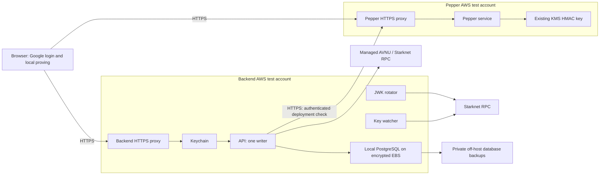

# Google-only Sepolia beta: lean hosting review

Updated 12 November 2026 against application baseline `4be8467`. **Design preparation only. No AWS resources, permissions, DNS or OAuth configuration changed. No deployment approval.** AWS, wallet/security, database and operational reviewers remain unassigned. Sensitive resource identifiers and credentials belong in private operator records.

## Selected direction

The user selected an open Google-only Sepolia beta at `sepolia.kamui.page` and `pepper-sepolia.kamui.page`, client-side proving, two existing separate AWS test accounts and Ireland for estimating. The latest cost decision supersedes ECS/Fargate and RDS: **use two small EC2 servers, with PostgreSQL on the backend server**. Cloudflare remains DNS-only. Direct HTTPS replaces the ALBs; NAT gateways, EFS, RDS and the previous ALB/WAF attachment are absent from this target. The lean package now supplies direct Caddy HTTPS, body/header limits, private service networks and application admission controls; effectiveness still needs review before public access. It does not provide an upstream WAF or guarantee protection against denial of service or asset-egress abuse.

Approved apps only may receive sponsorship, anonymous sponsorship is off, and explicit per-account/per-app/overall limits are required. Wallet deployment/recovery funding has separate limits. Exact amounts, app authentication, AVNU external controls and operator ownership remain unresolved. The current memory ledger is insufficient for restart-safe spending budgets.

The [cost estimate](COST_ESTIMATE.md) models about $56/month with a 2 GiB backend or $72/month with 4 GiB. The implemented container limits leave insufficient verified OS/backup headroom on 2 GiB; recommend 4 GiB and a $100/month planning target pending measurement. No ceiling is approved or enforced. The earlier [Fargate review](FARGATE_HOSTING_REVIEW.md) and [estimate](FARGATE_COST_ESTIMATE.md) are comparison material. Existing Terraform still describes the older Fargate/SQLite/EFS implementation and must not be applied as this design.

## Proposed topology

Candidate sizing is x86 Linux `t3.small` (2 GiB) for backend and `t3.micro` (1 GiB) for pepper, with 40 GB combined gp3 storage. Backend hosts keychain, one API process, PostgreSQL, rotator and watcher; pepper hosts only its HTTPS proxy and pepper application. No proving server or hosted demo is included. Benchmark resident memory and CPU credits before accepting sizing; `t3.medium` (4 GiB) is the priced fallback. Burstable surplus CPU charges and deployment overlap are not measured.

Use a maintained HTTPS reverse proxy, such as Caddy, with automated certificate renewal. The API and database bind only to a local interface/private container network and have no public port. Keychain remains the API's only public route. Native services or separate containers must run under separate users; container volumes must survive replacement. Host compromise can cross these local boundaries: these are not separate machine trust domains.

## Review and implementation gates

| Decision | Selected or proposed direction | Remaining review |
|---|---|---|
| R1 Scope | Open Google-only Sepolia beta and selected subdomains | OAuth audience/callback, release protections and browser acceptance |
| R2 Placement | Two existing accounts; two EC2 servers; Ireland estimate | Actual key Region, profiles, permissions, encrypted volumes, maintenance and operator access |
| R3 Persistence | PostgreSQL on backend server | Migration, transactions, disk sizing, off-host backups and fenced restore |
| R4 Public boundary | DNS-only Cloudflare; HTTPS directly at each server; API/database local-only | Edge abuse controls, trusted proxy identity, TLS renewal, proof body sizes and origin exposure |
| R5 Release | Pinned client Wasm/proof profile; no server fallback | Reproducible production images, notices, hashes, browser memory/transfer and supported clients |
| R6 Signing | Pepper HMAC key unchanged | Relayer/registry signer separation, credential consumers and nonce ownership still undecided |
| R7 Spending | Approved apps, anonymous sponsorship off, explicit durable limits | App authentication, atomic debit/reconciliation, exact thresholds, AVNU controls and pause path |
| R8 Privacy | No sensitive request bodies in logs | Analytics/retention proposals and vendor/privacy review still undecided |
| R9 Operations | About $56/month model; $75 target proposed | Budget approval, named payer/operator, patching, alerts, RPO/RTO and restore drill |

EC2 instance profiles provide temporary AWS credentials; do not add long-lived AWS credentials to server files. Review per-process access to host role credentials: a backend instance profile does not isolate keychain from API or rotator. The pepper role must remain limited to its intended KMS operations. Changing roles/key policies/security groups is an operator action after review. [EC2 roles](https://docs.aws.amazon.com/AWSEC2/latest/UserGuide/iam-roles-for-amazon-ec2.html)

Direct EC2 origins do not provide an AWS WAF association. Host/proxy rate limits, application admission, durable budgets and operator pause controls need an explicit reviewed design; they are not equivalent to managed WAF or upstream denial-of-service protection. If public exposure cannot be accepted under those controls, add a separately priced supported edge rather than claim the budget includes one. Cloudflare proxying is not silently enabled. [WAF supported resources](https://docs.aws.amazon.com/waf/latest/developerguide/how-aws-waf-works-resources.html)

The existing application must migrate from SQLite to PostgreSQL for recovery jobs and registry replay state. Preserve atomic admission, unique active-account locks, compare-and-swap journal transitions, nonce uniqueness and pruning. Add durable sponsorship/deployment funding state. Keep one API writer, including across releases; co-location does not fix shared signer nonces. Application adapters, explicit offline SQLite import, transaction tests and same-connection PostgreSQL writer fencing are now implemented locally; see [POSTGRESQL.md](../../../services/backend/POSTGRESQL.md). The existing developer databases were not migrated. Durable count/FRI spending counters and persisted pause are now implemented, with all paid operations initially off. Hosted cutover remains pending; the keychain's own wallet-management sponsorship still needs a separately reviewed owner-authenticated route.

## Backup and recovery proposal

Local EBS persistence covers ordinary process/container restart; it does not replace backups or provide automatic database failover. Recommend off-host encrypted PostgreSQL base backups plus continuous WAL archiving, with backup failure/lag and disk-space alerts. Retention, RPO and RTO need decisions and measured restore evidence; no interval is promised here. Simple daily dumps alone can lose a day's journal history. Base backups plus a continuous WAL sequence support point-in-time recovery; logical dumps cannot substitute for that WAL base backup. [PostgreSQL recovery documentation](https://www.postgresql.org/docs/current/continuous-archiving.html)

**Restore fencing is required:** a restored snapshot may omit a paid transaction or consumed nonce. Keep admission, relaying, sponsorship and rotator writes stopped after restoring stale data. Reconcile the known signer transaction history and on-chain account state, retain uncertain locks, and rebuild conservative budget/replay state before resuming. If completeness cannot be established, remain paused for operator resolution. Never delete a lock or retry a payment merely because the restored database lacks its record.

Off-host backups must remain private and must not collect browser witnesses, JWTs, peppers or private proving state. Database backups may contain journal capabilities/replay metadata in protected forms and session display data; access and retention require review. Keep the existing HMAC key in KMS; do not add a key-material backup. Pepper export remains the user's separate recovery-file flow.

## Next implementation work

1. PostgreSQL stores, explicit SQLite import and durable funding counters are implemented locally. Review policy thresholds/app credentials before enabling any funding; wallet-management sponsorship remains off.
2. Review the prepared [lean deployment package](../lean/README.md): separate host stacks, direct HTTPS, scoped secret files, stop-before-start releases, monitoring and operator-only provisioning. No cloud deployment is verified.
3. Backup/WAL archiving and host restore fencing are implemented; the disposable local base-backup plus WAL restore drill passed. Review retention, bucket/key/role controls, RPO/RTO and real alert delivery before hosted use.
4. Obtain AWS/security/operations review, then give the operator concrete provisioning/DNS commands. Hosted-origin acceptance remains in [HOSTING_ACCEPTANCE.md](HOSTING_ACCEPTANCE.md).

Application evidence: local Google existing-account recovery passed on Sepolia in run 11. That is not evidence for this hosting layout, first deployment, cloud restore or broader browser compatibility. No cloud capacity test, account-aware plan or deployment has run.
